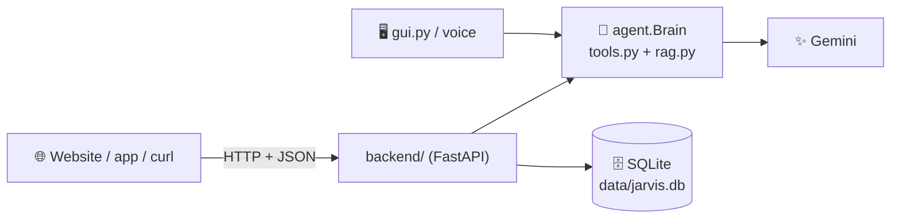
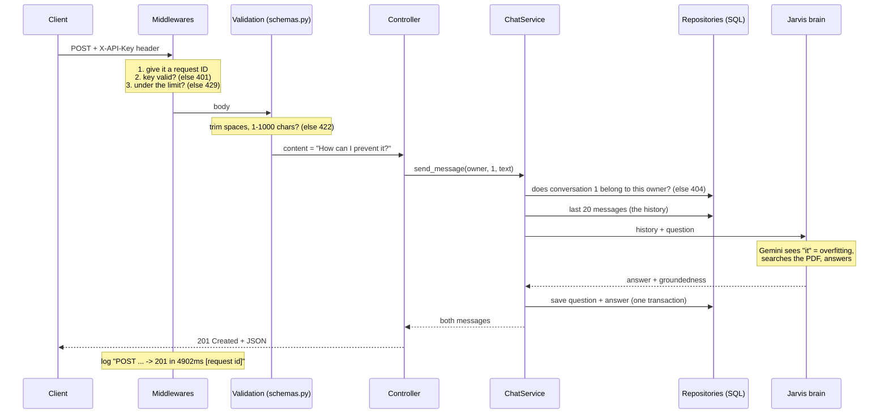

# Jarvis API: the backend

The desktop Jarvis (`gui.py`, `agent.py`) works only on your computer. The **Jarvis API** puts
the **same brain** behind a REST API, so a website, phone app or any program can use it:
chat with Jarvis, search your PDFs, and get the weather.

Nothing in the desktop app changed. Both use the same `agent.py`, `tools.py`, `rag.py` and
the same `documents/` folder, so a PDF uploaded through the API can also be asked about by voice.



---

## 1. Run it (first time)

```powershell
cd E:\agent
.\.venv\Scripts\python.exe -m pip install -r requirements.txt   # adds fastapi, uvicorn...
.\.venv\Scripts\python.exe -m backend.migrate up                 # create the database tables
.\.venv\Scripts\python.exe -m backend.manage create-key "me"     # copy the key it prints!
.\.venv\Scripts\python.exe -m uvicorn backend.main:app --reload  # start the server
```

Open **http://127.0.0.1:8000/docs**, click **Authorize**, paste your key, and try every
endpoint from the browser. Run the tests with `.\.venv\Scripts\python.exe -m pytest -v`.

---

## 2. Where each concept lives

| Concept | File | What to look at |
|---|---|---|
| **REST + HTTP methods** | `backend/controllers/conversations.py` | `POST` creates, `GET` reads, `DELETE` removes. Nouns in URLs (`/conversations/5/messages`), never verbs |
| **Status codes** | controllers | `201 Created` (+ `Location` header), `202 Accepted` (upload), `204 No Content` (delete), `401`, `404`, `413`, `422`, `429`, `503` |
| **Controllers** | `backend/controllers/` | Only HTTP work: take validated input, call **one** service method, return a response |
| **Services** | `backend/services/` | Business rules: "only the owner can see a chat", "name the chat after the first question" |
| **Repositories** | `backend/repositories/` | The **only** place with SQL. One class per table |
| **SQL** | repositories + `migrations/` | `JOIN`, `GROUP BY`, `COUNT`, subqueries, `LIMIT/OFFSET`, `RETURNING`, indexes, foreign keys, `CHECK`, `ON DELETE CASCADE` |
| **Migrations (up/down)** | `backend/migrations/`, `backend/migrate.py` | Numbered pairs of files. `004` shows how to **change** an existing table with a new migration |
| **Transactions** | `services/chat_service.py` | `with self.db:` saves the question and the answer together, or neither |
| **Middlewares** | `backend/middlewares.py` | Request ID + timing + logging, API-key auth, rate limiting |
| **Validation** | `backend/schemas.py` | Empty, too long, wrong type → `422` before your code runs |
| **Transformation** | `backend/schemas.py` | `"  MUMBAI "` → `"Mumbai"`; database text dates → JSON datetimes |
| **Stateless vs stateful** | `backend/services/jarvis.py` | The API keeps no chat in memory; it reloads history from the DB on every request |
| **Cache** | `backend/cache.py`, `services/weather_service.py` | Cache-aside with expiry (TTL), plus invalidation after a PDF upload |
| **Dependency injection** | `backend/dependencies.py` | Lets tests swap the real Jarvis for a fake one |
| **Error handling** | `backend/errors.py`, `main.py` | Services raise `NotFoundError`; `main.py` turns it into a `404` with one JSON shape |
| **Auth / security** | `services/auth_service.py`, `document_service.py` | Hashed API keys, owner checks, safe filenames (no `../../`), PDF content check |
| **Background jobs** | `controllers/documents.py` | Upload answers `202` at once; indexing runs after the response |
| **Tests** | `tests/test_api.py` | 10 tests. Fake Jarvis, fresh database each time, no internet needed |

---

## 3. The path of one request

`POST /api/conversations/1/messages` with `{"content": "  How can I prevent it? "}`:



---

## 4. All endpoints

| Method | Path | What it does |
|---|---|---|
| GET | `/health` | Server and database status (no key needed) |
| POST | `/api/conversations` | Start a chat |
| GET | `/api/conversations?limit=20&offset=0` | Your chats, newest first (paginated) |
| GET | `/api/conversations/{id}` | One chat with its messages |
| DELETE | `/api/conversations/{id}` | Delete a chat |
| POST | `/api/conversations/{id}/messages` | Ask Jarvis (uses Gemini) |
| GET | `/api/documents` | Searchable PDFs (cached) |
| POST | `/api/documents` | Upload a PDF → `202`, indexing in background |
| GET | `/api/documents/uploads/{id}` | Upload status: pending / indexing / ready / failed |
| GET | `/api/documents/search?q=...&intent=fact` | Search PDFs directly (no Gemini quota) |
| GET | `/api/weather?city=Mumbai` | Weather, cached for 10 minutes (`X-Cache: HIT/MISS`) |

Try it from PowerShell:
```powershell
$h = @{ "X-API-Key" = "jv_...your key..." }
$c = Invoke-RestMethod -Method Post -Uri http://127.0.0.1:8000/api/conversations -Headers $h -ContentType "application/json" -Body '{}'
Invoke-RestMethod -Method Post -Uri "http://127.0.0.1:8000/api/conversations/$($c.id)/messages" -Headers $h -ContentType "application/json" -Body '{"content":"What is overfitting, according to my PDF?"}'
```

---

## 5. Measured results

From a real run on this project:

| | Result |
|---|---|
| Weather, first call (cache MISS) | 3,153 ms |
| Weather, same city again (cache HIT) | **11 ms** |
| Follow-up "How can I prevent it?" | Understood as "how to prevent overfitting", because the history was reloaded from the database |
| Tests | 10 passed in about 6 seconds |

---

## 6. Honest limits (good next steps)

| Limit now | Production fix | What you'd learn |
|---|---|---|
| Cache and rate limiter live in memory (one process only) | Redis | Shared state, distributed systems |
| SQLite (one file) | PostgreSQL | Connection pools, real DB server |
| One Gemini question at a time (`RAG_LOCK`) | Move rag.py's per-question state into each request | Concurrency, thread safety |
| Background indexing stops if the server restarts | A job queue (Celery / RQ) | Workers, retries |
| Uploaded PDFs are shared by all users | `owner` column on documents + filtering in ChromaDB | Multi-tenancy |
| Runs only on your PC | Docker + a cloud host | Deployment |
