# Jarvis — Voice Agent with Tool Calling

A small voice assistant that runs on your computer.

- You wake it up by saying **"Hey Jarvis"**.
- It answers: **"Yes, I am listening. How can I assist you?"**
- You ask something like **"Can you please tell me the weather for today in Mumbai?"**
- It uses **Gemini** (Google's AI) to understand you. Gemini picks the right **tool** (for example the weather tool), the tool fetches real data, and Jarvis speaks the answer back to you.

> **Seeing the diagrams:** they are written in Mermaid. GitHub shows them automatically.
> In VS Code, install the extension **"Markdown Preview Mermaid Support"** and press
> `Ctrl + Shift + V` to open the preview.

### What's in this README

| Part | Sections | About |
|---|---|---|
| **Part 1: The voice agent** | 1 – 9 | Wake word, Gemini tool calling, the 13 tools, RAG over your PDFs, setup |
| **Part 2: The backend (Jarvis API)** | 10 – 15 | Everything added to turn Jarvis into a production-style REST API |
| ↳ [10. What changed](#10-what-changed-the-full-change-log) | | Every file added or modified, and why |
| ↳ [11. Architecture](#11-backend-architecture) | | Layers, database schema, the path of one request |
| ↳ [12. Concepts in this project](#12-every-backend-concept-in-this-project) | | REST, controllers, services, repositories, SQL, migrations, middlewares, validation, stateless, cache... each with the real code |
| ↳ [13. Design decisions](#13-design-decisions-and-trade-offs) | | Why it's built this way, and the trade-offs |
| ↳ [14. Running and testing](#14-running-and-testing-the-backend) | | Commands, endpoints, tests |
| ↳ [15. Interview guide](#15-interview-guide) | | How to present this project, and answers to likely questions |
| ↳ [16. Long-term memory](#16-long-term-memory-instant-answers-and-voice-memory) | | **New:** instant answers to repeated questions (6 s → 0.02 s) and voice Jarvis remembering earlier days |
| ↳ [17. Noise handling (VAD)](#17-noise-handling-voice-activity-detection-vad) | | **New:** a small neural network ignores fans, music and other non-voice noise |

---

## 1. The big picture

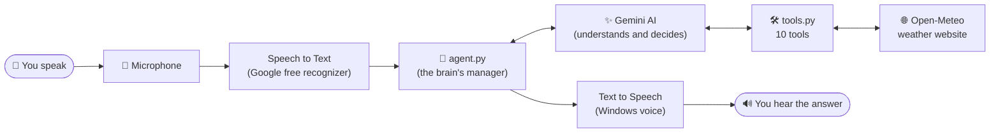

In simple words:
1. **Ears:** the microphone records you, and speech-to-text turns your voice into text.
2. **Brain:** Gemini reads the text and decides what to do.
3. **Hands:** if data is needed (weather, time), Gemini asks a tool to fetch it.
4. **Mouth:** the answer is turned back into voice and played on your speaker.

---

## 2. The project files

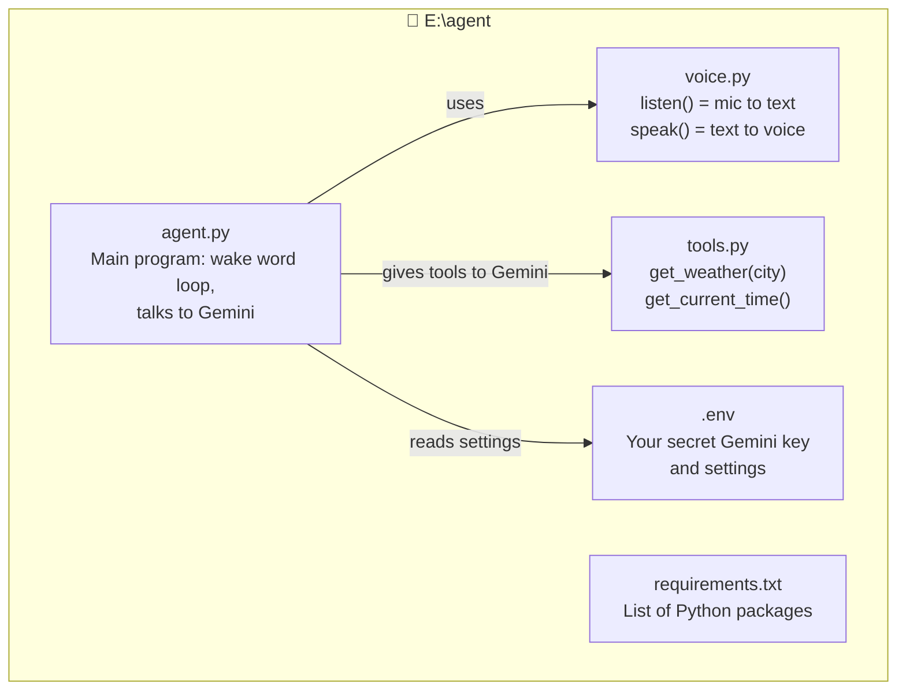

| File | What it does, in one line |
|---|---|
| `rag.py` | RAG pipeline: indexing, hybrid search, reranking, compression, traces. |
| `guardrails.py` | Safety checks: prompt-injection blocking and answer groundedness. |
| `eval_rag.py` | Measures RAG quality on the test set in `eval/`. |
| `gui.py` / `Jarvis.bat` | The desktop window. Double-click `Jarvis.bat` to open it. |
| `agent.py` | The main program. It waits for "Hey Jarvis", sends your question to Gemini, and speaks the reply. |
| `voice.py` | Two helpers: `listen()` (microphone to text) and `speak()` (text to voice). |
| `tools.py` | The tools Gemini is allowed to use. Right now: weather, forecast, time, calculator, open website, open app, Wikipedia, currency, reminders, system info, and PDF search (from `rag.py`). |
| `.env` | Your private settings: Gemini key, agent name, default city. **Never share this file.** |
| `.env.example` | A blank template of `.env`, safe to share. |
| `requirements.txt` | The Python packages the project needs. |
| `backend/` | **The REST API** (Part 2): controllers, services, repositories, migrations, middlewares. |
| `tests/` | Automated tests for the API (`pytest`). |
| `BACKEND.md` | Short quick-start for the API. Part 2 of this README explains it in depth. |

---

## 3. Step by step: what happens when you talk

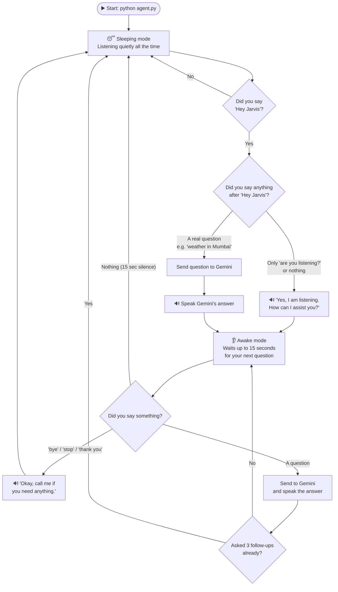

Important points:
- Jarvis **ignores everything** until it hears "Hey Jarvis" (also "Hi Jarvis", "Hello Jarvis" or "OK Jarvis").
- You can do it in one go: **"Hey Jarvis, what's the weather today?"**
- After waking up, you can ask **up to 3 more questions** without saying "Hey Jarvis" again.
- If you stay silent for about 15 seconds, it goes back to sleep.

---

## 4. How tool calling works (the most important part)

"Tool calling" means **the AI does not guess the weather; it asks your code to fetch the real weather.**

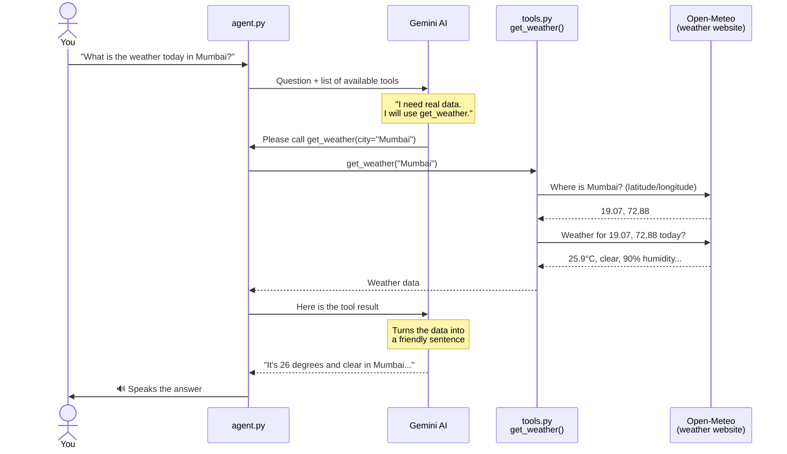

**Who decides which tool to use?** Gemini does. It reads the **description (docstring)** written above each tool function in `tools.py`. When your question matches a description, Gemini calls that tool.

**Who runs the tool?** Your computer does. The Google `google-genai` library runs the Python function automatically and sends the result back to Gemini. This is called *automatic function calling*.

If you ask for the weather **without naming a city**, Jarvis uses the `DEFAULT_CITY` from `.env`.

---

## 4b. Asking questions about your PDF (RAG)

RAG means **Retrieval-Augmented Generation**: before answering, Jarvis *retrieves* the right parts of your PDF, and Gemini *generates* the answer only from them. It doesn't guess.

Jarvis uses a **production-style RAG pipeline** (`rag.py` and `guardrails.py`). Every stage except the final answer runs **locally**, so it costs **no extra Gemini quota**.

**Step A: When you upload a PDF (happens once per PDF)**
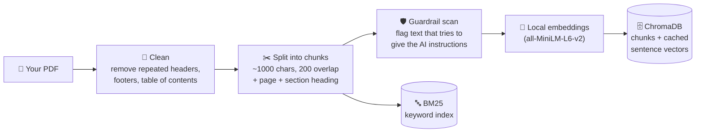

**Step B: The 5 stages that run when you ask a question**
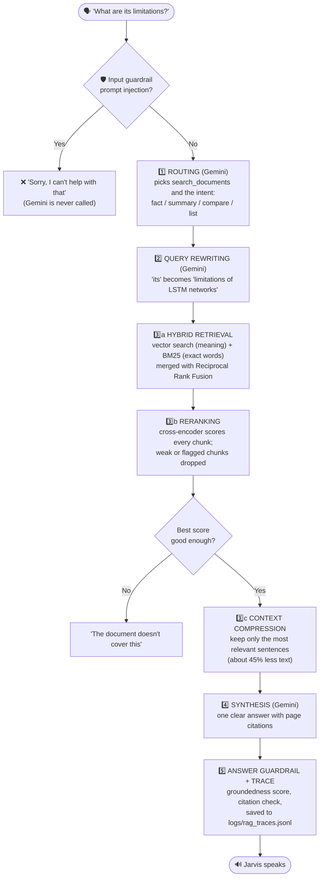

**What each stage means, simply**

| Stage | In simple words | Where |
|---|---|---|
| 1. Routing | Gemini decides "this is a PDF question" and what kind: a fact, a summary, a comparison or a list. Each kind gets a different amount of context (see `STRATEGIES`). | Gemini function call |
| 2. Query rewriting | Follow-ups like "what are its limitations?" are rewritten so they make sense alone. | Gemini, in the same call |
| 3a. Hybrid retrieval | Two searches: by **meaning** (vectors) and by **exact words** (BM25, good for names and terms like "F1"). The results are merged. | `rag.py`, local |
| 3b. Reranking | A small **cross-encoder** model reads the question and each chunk **together** and scores how well it answers. Unrelated chunks score about −10 and are dropped. | `rag.py`, local |
| 3c. Compression | From each kept chunk, only the sentences closest to the question are sent to Gemini. | `rag.py`, local |
| 4. Synthesis | Gemini merges the passages into one answer of up to 5 sentences and cites pages. | Gemini |
| 5. Guardrails and evaluation | Blocks injection attempts, ignores instructions hidden inside PDFs, scores how well the answer is supported, checks cited pages, and logs everything. | `guardrails.py`, `rag.py`, local |

**Measuring quality: `eval_rag.py`**

```powershell
.\.venv\Scripts\python.exe eval_rag.py              # retrieval metrics only (no Gemini quota)
.\.venv\Scripts\python.exe eval_rag.py --generate   # also scores Gemini's answers
```
It runs 20 labelled questions from `eval/rag_eval_set.json` (17 the book covers, 3 it doesn't) and compares the full pipeline with a naive baseline (vector search, top 4). Results on `Machine_Learning_From_Zero_to_Advanced.pdf`:

| Metric | Naive baseline | Full pipeline |
|---|---|---|
| Hit rate (right page found) | 1.00 | 1.00 |
| MRR (right page ranked first) | 1.00 | 1.00 |
| Context precision (share of useful passages) | 0.77 | **0.79** |
| Out-of-scope rejection | 0.00 | **1.00** |
| Text sent to Gemini (characters) | 3,528 | **1,945** (−45%) |
| Groundedness (answer supported by text, 0–1) | – | 0.75 |
| Answer relevance (0–1) | – | 0.77 |
| Citation accuracy | – | 1.00 |
| Correct refusals | – | 1.00 |

Every answer is also logged in `logs/rag_traces.jsonl`: the rewritten query, intent, candidates, rerank scores, kept pages, compression, time per stage, answer and checks.

**How to add a PDF**
- **Desktop window:** click **Upload PDF** and choose a file. Wait for the yellow line that says `Ready: ...`.
- **Terminal:** copy the PDF into `E:\agent\documents\`. It's indexed automatically the next time Jarvis starts.
- **By hand:** `.\.venv\Scripts\python.exe rag.py` indexes the folder. `.\.venv\Scripts\python.exe rag.py "your question"` tests a search without Gemini.

**Example questions** (for `Machine_Learning_From_Zero_to_Advanced.pdf`):
- "Hey Jarvis, according to the PDF, what is the difference between precision and recall?"
- "What does the book say about transformers and attention?"
- "What does my document say about overfitting?"
- "Which documents have I uploaded?"

If the answer isn't in the PDF, Jarvis says so instead of making something up.

Good to know:
- Searching uses a **local** embedding model, so it costs **no Gemini quota**. Only the final answer uses Gemini.
- Scanned PDFs (photos of pages) have no readable text and can't be searched.
- To remove a PDF, delete it from `documents/` and delete the `.rag_db` folder. It's rebuilt on the next start.

---

## 4c. How closing apps and websites works

When you say **"Hey Jarvis, close my Notepad"**, Gemini calls the `close_app("notepad")` tool in `tools.py`. That tool does the actual closing on your computer.

### The idea in one line
Every open program on Windows has one or more **windows**. Jarvis **finds the right window** and **asks it to close**, the same as if you clicked its **X** button.

### Step 1: Jarvis makes a list of every open window

Windows can give a program the list of all open windows. For each window, Jarvis notes 3 things:

| Handle (window ID) | Program (process) | Title (text on the top bar) |
|---|---|---|
| 5180444 | `notepad.exe` | `*My notes - Notepad` |
| 3017034 | `chrome.exe` | `(1) WhatsApp - Google Chrome` |
| 3671170 | `msedge.exe` | `YouTube - Microsoft Edge` |
| 2229066 | `code.exe` | `agent - Visual Studio Code` |

Jarvis's **own** window is always left out of this list, so it can never close itself.

### Step 2: Decide what kind of thing you asked to close

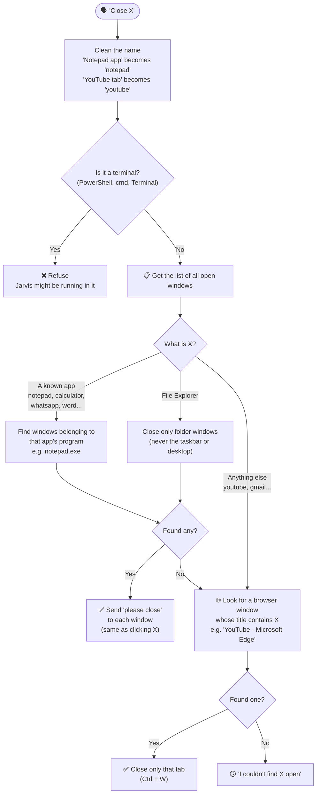

### Step 3a: How an app is closed (Notepad, WhatsApp, Word...)

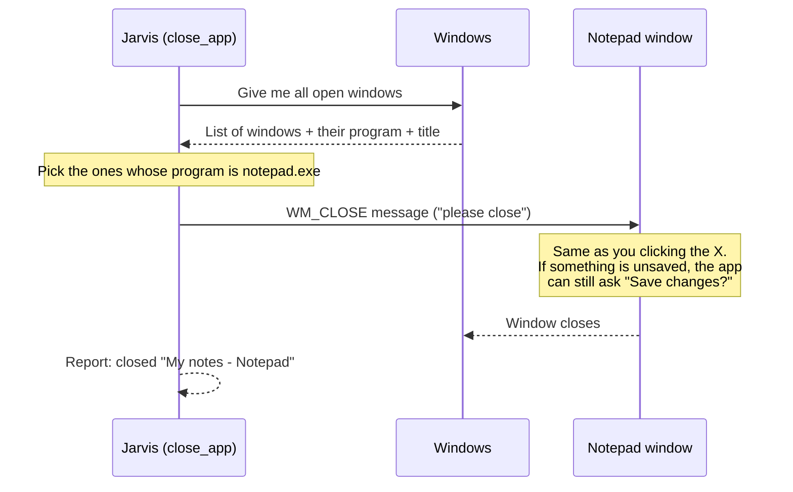

- Jarvis **asks** the app to close. It doesn't force-kill it, so apps can still save your work. Windows 11 Notepad even keeps unsaved tabs for next time.
- Store apps like **Calculator**, **Settings** and **WhatsApp** show their window under a different program name, so Jarvis also matches them by their **exact window title** ("Calculator", "WhatsApp").

### Step 3b: How a website tab is closed (YouTube, Gmail...)

A website isn't a program. It's a **tab inside a browser**, and closing the whole browser would close all your other tabs too. So Jarvis closes **just that tab**:

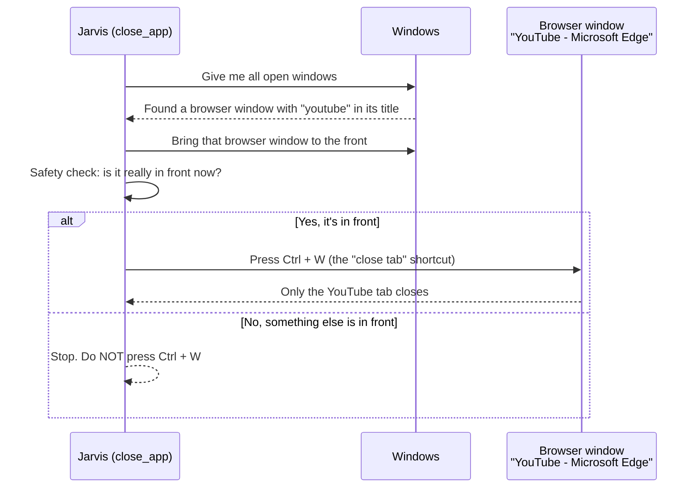

**Why the safety check matters:** Ctrl + W closes whatever is in front. If Jarvis pressed it while VS Code was in front, it would close your code file. So Jarvis only presses it after confirming the browser window is in front.

**Why only the tab you're looking at:** a browser window's title shows only its **current** tab. If YouTube is open but hidden behind another tab, the title doesn't mention YouTube, so Jarvis can't find it and says so.

### Closing several things at once

When you say *"Close Notepad and YouTube"*, Gemini simply calls the tool twice:

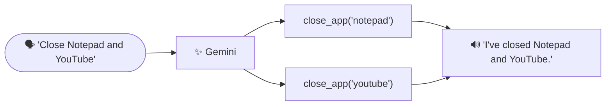

### Safety rules (summary)

| Rule | Why |
|---|---|
| Never closes Jarvis's own window | So it can't shut itself down |
| Refuses PowerShell, cmd, Terminal | Jarvis might be running inside one |
| File Explorer: closes folder windows only | Closing `explorer.exe` itself would make the taskbar disappear |
| Asks apps to close (WM_CLOSE), never force-kills | You get the chance to save your work |
| Presses Ctrl + W only after checking the browser is in front | So it never closes a tab or file in another program |

### Adding a new app that can be closed

Open `tools.py` and add a line to `CLOSABLE_APPS`:
```python
"zoom": ({"zoom.exe"}, None),   # spoken name: ({program name}, exact window title or None)
```
To find an app's program name, open **Task Manager → Details** while the app is running.

---

## 5. Setup (one time only)

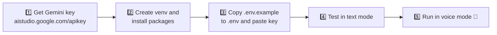

**Step 1: Get a Gemini API key**
Go to https://aistudio.google.com/apikey, click **Create API key** and copy it.
A correct key **starts with `AIza`**.

**Step 2: Install everything.** Open the VS Code terminal with `` Ctrl + ` ``:
```powershell
cd E:\agent
python -m venv .venv
.\.venv\Scripts\python.exe -m pip install -r requirements.txt
```
(This is already done on your computer.)

**Step 3: Add your keys (1 to 10)**
```powershell
copy .env.example .env
```
Open `.env` and fill in as many key slots as you have. Leave the others empty:
```
GEMINI_API_KEY_1=AIzaSy...first key...
GEMINI_API_KEY_2=AIzaSy...second key...
GEMINI_API_KEY_3=
...
GEMINI_API_KEY_10=
AGENT_NAME=Jarvis
DEFAULT_CITY=Mumbai
GEMINI_MODEL=gemini-3.5-flash-lite
```

| Setting | Meaning |
|---|---|
| `GEMINI_API_KEY_1` ... `_10` | Your secret keys. At least one is required. |
| `AGENT_NAME` | The wake word name. If you set `Friday`, you say "Hey Friday". |
| `DEFAULT_CITY` | The city used when you don't name one. |
| `GEMINI_MODEL` | Which Gemini model to try first. If it is busy, Jarvis switches to a backup model automatically. |

---

## 6. Running it

**Desktop app (easiest):** double-click **`Jarvis.bat`** in the `E:\agent` folder, or run:
```powershell
.\.venv\Scripts\python.exe gui.py
```

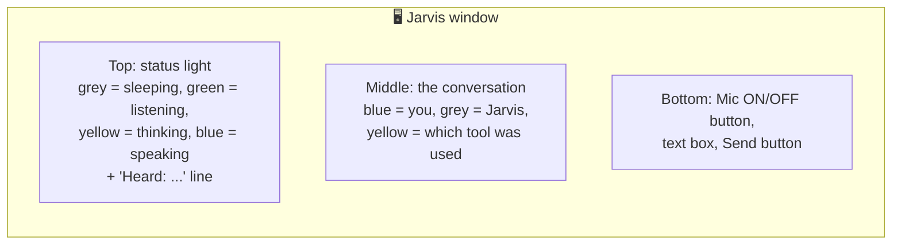

- Speak ("Hey Jarvis, ...") **or** type in the box and press Enter. Typing doesn't need the wake word.
- The **"Heard:"** line shows exactly what the microphone understood, so you can see why it did or didn't wake up.
- Click **Mic ON** to turn the microphone off, and click again to turn it back on.

**Text mode** (type in the terminal instead of speaking; good for testing):
```powershell
.\.venv\Scripts\python.exe agent.py --text
```
```
You (type): hey jarvis are you listening
Agent: Yes, I am listening. How can I assist you?
You (type): what is the weather today in mumbai
Agent: It's currently 26 degrees and clear in Mumbai, with a high of 32...
```

**Voice mode** (real microphone and speaker):
```powershell
.\.venv\Scripts\python.exe agent.py
```
Say out loud: **"Hey Jarvis, are you listening?"**

Press **`Ctrl + C`** to stop the program.

### Things you can say
| You say | Tool used |
|---|---|
| "Hey Jarvis, are you listening?" | none (fixed greeting) |
| "What's the weather today in Delhi?" | `get_weather` |
| "Will it rain today?" | `get_weather` (uses `DEFAULT_CITY`) |
| "Will it rain tomorrow in Mumbai?" / "Weather this week?" | `get_weather_forecast` |
| "What time is it?" / "What's today's date?" | `get_current_time` |
| "What is 245 times 18?" / "What is 18% of 1200?" | `calculate` |
| "Open YouTube" / "Open Gmail" | `open_website` |
| "Open my Notepad, YouTube and WhatsApp" | `open_app` + `open_website` (one call each) |
| "Close my Notepad" / "Close YouTube" / "Close WhatsApp" | `close_app` (apps close normally; for websites only that tab is closed) |
| "Open Notepad" / "Open Calculator" / "Open VS Code" | `open_app` (only apps in the `APPS` list in `tools.py`) |
| "Who is APJ Abdul Kalam?" / "Tell me about the Taj Mahal" | `wikipedia_summary` |
| "Convert 100 dollars to rupees" | `convert_currency` |
| "Remind me in 5 minutes to drink water" / "Set a 30 second timer" | `set_reminder` (speaks and shows a pop-up) |
| "What is my battery percentage?" | `get_system_info` |
| "Tell me a joke" | none (Gemini answers by itself) |
| "Bye" / "Thank you" / "Stop" | puts Jarvis back to sleep |

---

## 7. Adding your own tool

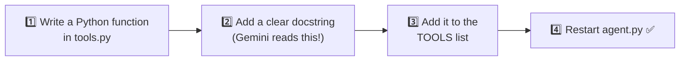

Example: a tool that tells a random fact.
```python
import random

def get_random_fact() -> dict:
    """Get a random fun fact. Use when the user asks for a fact or something interesting."""
    facts = ["Honey never spoils.", "Octopuses have three hearts."]
    return {"fact": random.choice(facts)}

TOOLS = [get_weather, get_current_time, get_random_fact]
```
Now say "Hey Jarvis, tell me a fun fact." Gemini will call your new tool.

Rules for good tools:
- Use **type hints** (`city: str`, `-> dict`) so Gemini knows what to send.
- Write a **clear docstring**, because that is how Gemini decides when to use the tool.
- **Return a dict** with simple values (text and numbers).

---

## 8. API keys: which ones you need

| Key | Needed? | Why |
|---|---|---|
| **Gemini** | ✅ Yes | The AI brain that understands you and calls tools. |
| Weather key | ❌ No | Open-Meteo is free and needs no key. |
| Hugging Face | ❌ No | Speech uses Google's free recognizer and the Windows built-in voice. |

---

## 9. Common problems

| Problem | Fix |
|---|---|
| `No Gemini API key found` | You don't have a `.env` file, or all the key lines are empty. See Step 3. |
| `Key 1 is out of quota or invalid, switching to key 2...` | Normal: Jarvis moved on to your next key. If it happens every time for one key, check that key in AI Studio. |
| `401 UNAUTHENTICATED` / `ACCESS_TOKEN_TYPE_UNSUPPORTED` | Wrong key type. Create a new key at aistudio.google.com/apikey. It must start with `AIza`. |
| `429` / quota error | You used up the free limit. The free plan allows about 5 questions per minute. Wait one minute and ask again. |
| It never reacts to "Hey Jarvis" | Check that Windows allows mic access (Settings → Privacy → Microphone), speak clearly, and watch the `You:` lines in the terminal to see what it heard. |
| It hears "hey jervis" or similar | Pick a short name that is easy to recognise, like `Nova` or `Max`, and set it as `AGENT_NAME`. |
| No sound | Check your speaker volume and default output device. |
| "Sorry, something went wrong" | Read the `[error]` line printed just above it in the terminal. |

---
---

# Part 2: The backend (Jarvis API)

Part 1 is a desktop app: it works for **one person, on one computer**. Part 2 puts the
**same brain** behind a **REST API**, so any website, phone app or program can use Jarvis
over HTTP. It also adds what a production backend needs: a database, migrations, login with
API keys, rate limiting, caching, validation, error handling, logging and tests.

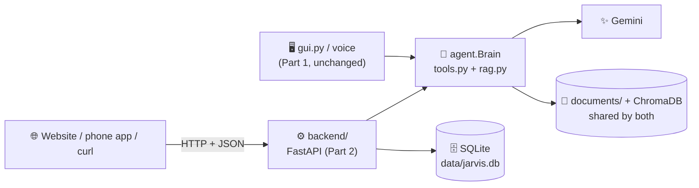

**Key idea:** the backend doesn't rebuild Jarvis. It adds a new *door* (HTTP) to the existing
brain. The desktop app and the API share the same `agent.py`, `tools.py`, `rag.py` and the same
`documents/` folder, so a PDF uploaded through the API can also be asked about by voice.

---

## 10. What changed: the full change log

### Summary

| | Count |
|---|---|
| New files | **45** (40 in `backend/`, 2 test files, `try_api.py`, `BACKEND.md`, `.gitignore`) |
| Existing files modified | **4** (`agent.py`, `gui.py`: long-term memory (section 16); `requirements.txt`: 5 packages; `README.md`) |
| Existing files untouched | `voice.py`, `tools.py`, `rag.py`, `guardrails.py`, `eval_rag.py`, `.env` |
| Database tables | **5** + 1 bookkeeping table (`schema_migrations`) |
| Migrations | **5** (each with an `up` and a `down` file) |
| API endpoints | **11** |
| Automated tests | **16** (all passing, about 8 seconds, no internet or Gemini needed) |

### Modified files

| File | Change | Why |
|---|---|---|
| `agent.py` | Added `Brain.load_history(history)` (4 lines) | The API keeps chats in the database. Before each question it must load that saved chat into the brain. Before this, `Brain` could only continue the chat it held in memory. |
| `requirements.txt` | Added `fastapi`, `uvicorn`, `python-multipart`, `pytest`, `httpx` | Web framework, web server, file uploads, tests, test HTTP client |
| `README.md` | Added Part 2 (this) | Documentation |

### New files, layer by layer

| Layer | File | What it does |
|---|---|---|
| **Entry point** | `backend/main.py` | Creates the app; registers middlewares, controllers and error handlers; checks migrations at startup |
| **Settings** | `backend/config.py` | Reads settings from `.env` (database path, rate limit, cache times, upload size) |
| **Controllers** | `backend/controllers/health.py` | `GET /health` |
| | `backend/controllers/conversations.py` | Create, list, read and delete chats; send a message to Jarvis |
| | `backend/controllers/documents.py` | Upload a PDF, check upload status, list PDFs, search PDFs |
| | `backend/controllers/weather.py` | Weather with a cache |
| **Services** | `backend/services/chat_service.py` | Chat rules: ownership, history, auto title, transactions |
| | `backend/services/document_service.py` | Upload checks, safe filenames, background indexing, cache invalidation |
| | `backend/services/weather_service.py` | Cache-aside around the weather tool |
| | `backend/services/auth_service.py` | Creates API keys and checks them (stored as hashes) |
| | `backend/services/jarvis.py` | **Bridge to the brain**: turns the stateful `Brain` into a stateless call |
| **Repositories** | `backend/repositories/api_key_repository.py` | SQL for `api_keys` |
| | `backend/repositories/conversation_repository.py` | SQL for `conversations` (with `JOIN` + `GROUP BY`) |
| | `backend/repositories/message_repository.py` | SQL for `messages` (with a subquery) |
| | `backend/repositories/upload_repository.py` | SQL for `document_uploads` |
| **Database** | `backend/database.py` | Opens a SQLite connection (foreign keys on, WAL mode) |
| | `backend/migrate.py` | Migration runner: `up`, `down`, `status` |
| | `backend/migrations/001…004` | 8 SQL files: 4 `up` + 4 `down` |
| **Cross-cutting** | `backend/middlewares.py` | Request ID + timing + logs, authentication, rate limiting |
| | `backend/schemas.py` | Pydantic models: validation and transformation of input and output |
| | `backend/errors.py` | Error classes and the single JSON error format |
| | `backend/cache.py` | In-memory cache with expiry (TTL) |
| | `backend/dependencies.py` | Dependency injection: gives each controller its services |
| **Tools** | `backend/manage.py` | Admin commands: create, list and revoke API keys |
| **Tests** | `tests/test_api.py`, `tests/test_memory.py` | 16 tests covering every concept |
| **Other** | `BACKEND.md`, `.gitignore` | Quick-start; keeps `.env` and databases out of git |

---

## 11. Backend architecture

### 11.1 The layers

Each layer has **one job** and only talks to the layer directly below it.

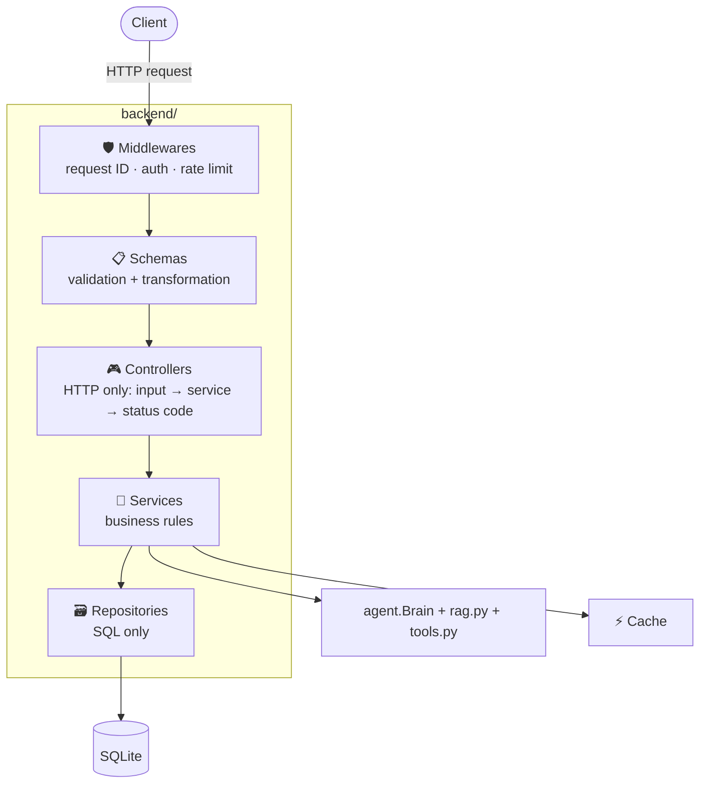

| Layer | Knows about | Does NOT know about |
|---|---|---|
| Controller | HTTP: paths, status codes, headers | SQL, business rules |
| Service | Business rules, transactions | HTTP (it raises `NotFoundError`, not "404") |
| Repository | SQL and tables | HTTP, business rules |

**Why it matters:** if you switch from SQLite to PostgreSQL, only repositories change. If you
add a GraphQL or WebSocket API, only controllers change. Each piece can be tested alone.

### 11.2 Database schema

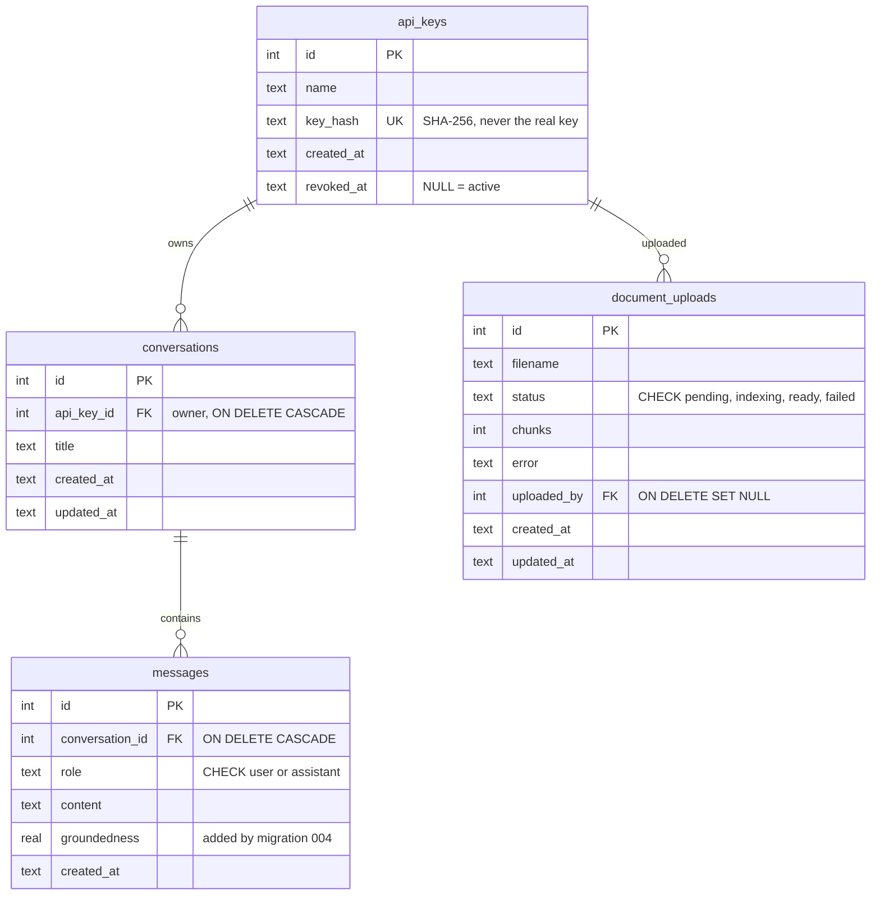

### 11.3 The path of one request

`POST /api/conversations/1/messages` with body `{"content": "  How can I prevent it? "}`:

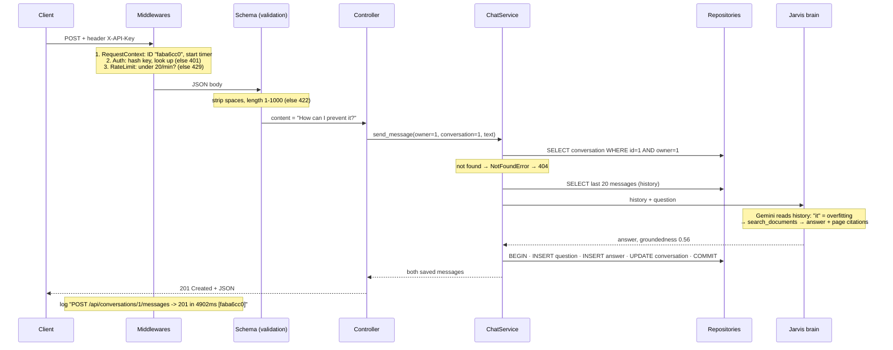

This happened in a real run: the follow-up question was understood as "how to prevent
overfitting", which proves the history was correctly reloaded from the database.

---

## 12. Every backend concept in this project

Each concept below has: **what it is**, **where it is**, **the real code**, and **why it's done this way**.

### 12.1 REST and HTTP methods
**What:** URLs name *things* (nouns); the HTTP method says *what to do* with them.
**Where:** `backend/controllers/`

| Method + path | Meaning | Success code |
|---|---|---|
| `POST /api/conversations` | create a conversation | `201 Created` + `Location` header |
| `GET /api/conversations?limit=20&offset=0` | list (paginated) | `200 OK` |
| `GET /api/conversations/5` | read one | `200 OK` |
| `DELETE /api/conversations/5` | delete one | `204 No Content` |
| `POST /api/conversations/5/messages` | create a message *inside* conversation 5 | `201 Created` |
| `POST /api/documents` | start a slow job | `202 Accepted` |

```python
@router.post("", status_code=201, response_model=ConversationOut)
def create_conversation(body: ConversationCreate, response: Response, ...):
    conversation = service.create(owner, body.title)
    response.headers["Location"] = f"/api/conversations/{conversation['id']}"  # where the new resource lives
```
**Why:** URLs like `/getConversation?id=5` or `/deleteChat` mix verbs into URLs. REST keeps one URL
per resource, and the method gives the action. `GET` is safe (changes nothing), and `GET`,
`DELETE` and `PUT` are idempotent (repeating them gives the same result).

**Error codes used:** `401` no or bad key · `404` not found · `413` file too big · `422` invalid input ·
`429` too many requests · `500` our bug · `503` Gemini or weather unreachable.

### 12.2 Controllers
**What:** the HTTP layer. Read the validated input, call **one** service method, return the response.
**Where:** `backend/controllers/conversations.py`
```python
@router.delete("/{conversation_id}", status_code=204)
def delete_conversation(conversation_id: int, owner: int = Depends(current_owner),
                        service: ChatService = Depends(get_chat_service)):
    service.delete(owner, conversation_id)
    return Response(status_code=204)
```
**Why:** "thin controllers". No SQL and no rules here, so the logic can be reused (for example
by `manage.py`) and tested without HTTP.

### 12.3 Services (business logic)
**What:** the rules of the application.
**Where:** `backend/services/chat_service.py` (shortened)
```python
def send_message(self, owner_id, conversation_id, text):
    conversation = self._owned(owner_id, conversation_id)          # rule: only the owner
    history = [(m["role"], m["content"]) for m in self.messages.latest(conversation_id, 20)]
    answer, groundedness = self.jarvis.reply(history, text)        # slow call OUTSIDE the transaction
    with self.db:                                                  # one transaction
        question = self.messages.add(conversation_id, "user", text)
        reply = self.messages.add(conversation_id, "assistant", answer, groundedness)
        if conversation["title"] == DEFAULT_TITLE:                 # rule: auto-name the chat
            self.conversations.rename(conversation_id, text[:50])
        self.conversations.touch(conversation_id)
```
**Why:** services raise `NotFoundError`, not "HTTP 404". They don't know HTTP exists.
`main.py` maps errors to status codes in one place.

### 12.4 Repository pattern + SQL
**What:** the **only** place that writes SQL. One class per table.
**Where:** `backend/repositories/`
```python
_SELECT = """
    SELECT c.id, c.title, c.created_at, c.updated_at, COUNT(m.id) AS message_count
    FROM conversations c
    LEFT JOIN messages m ON m.conversation_id = c.id
"""
def list_for_owner(self, owner_id, limit, offset):
    return self.db.execute(
        _SELECT + "WHERE c.api_key_id = ? GROUP BY c.id ORDER BY c.updated_at DESC, c.id DESC LIMIT ? OFFSET ?",
        (owner_id, limit, offset)).fetchall()
```
SQL features used in the project:

| Feature | Where | Why |
|---|---|---|
| `LEFT JOIN` + `GROUP BY` + `COUNT` | conversation list | message count in **one** query (avoids the N+1 query problem); `LEFT` keeps empty chats |
| Subquery | `MessageRepository.latest()` | take the last 20 messages (`ORDER BY id DESC LIMIT 20`), then re-sort them oldest-first |
| `LIMIT ? OFFSET ?` | conversation list | pagination |
| `INSERT ... RETURNING` | all `create` methods | get the new row back without a second `SELECT` |
| `?` placeholders | everywhere | **prevents SQL injection**: values never become part of the SQL text |
| `FOREIGN KEY ... ON DELETE CASCADE` | messages → conversations | deleting a chat deletes its messages automatically |
| `ON DELETE SET NULL` | uploads → api_keys | keep the upload record if the key is deleted |
| `CHECK (role IN ('user','assistant'))` | messages | the database itself rejects bad data |
| `UNIQUE` | `api_keys.key_hash` | no duplicate keys |
| Indexes | `(api_key_id, updated_at)`, `(conversation_id, id)` | the two most common queries don't scan the whole table |

### 12.5 Migrations (up and down)
**What:** version control for the database schema. Each change is a numbered pair of SQL files.
**Where:** `backend/migrations/`, runner in `backend/migrate.py`
```
001_create_api_keys              up: CREATE TABLE api_keys          down: DROP TABLE api_keys
002_create_conversations         up: CREATE conversations, messages down: DROP both (reverse order)
003_create_document_uploads      up: CREATE TABLE document_uploads  down: DROP TABLE
004_add_groundedness_to_messages up: ALTER TABLE ADD COLUMN         down: ALTER TABLE DROP COLUMN
```
```python
def _run(db, sql_file, bookkeeping):
    """Run a migration and record it in ONE transaction: either both happen or neither does."""
    script = f"BEGIN;\n{sql_file.read_text()}\n{bookkeeping}\nCOMMIT;"
```
How it works:
1. The `schema_migrations` table stores which versions have run.
2. `up` runs every file not in that table, in number order, and records it.
3. `down` runs the `.down.sql` of the **latest** one and removes its record.
4. Each migration and its record are in **one transaction**. If the SQL fails halfway, nothing
   changes, so the database is never left half-migrated.
5. The server **refuses to start** if migrations are pending (fail fast; see `lifespan` in `main.py`).

**Why 004 exists:** it shows the golden rule. **Never edit a migration that already ran.**
Other machines have already applied it. To change a table, add a new migration.

### 12.6 Middlewares
**What:** code that wraps **every** request, before and after the controller.
**Where:** `backend/middlewares.py`
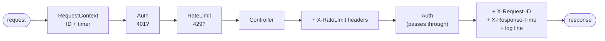
| Middleware | Before the controller | After the controller |
|---|---|---|
| `RequestContextMiddleware` | creates a request ID, starts a timer | adds `X-Request-ID` and `X-Response-Time`, writes one log line; turns crashes into a clean `500` |
| `AuthMiddleware` | hashes `X-API-Key`, looks it up; **stops** with `401` if it's wrong | – |
| `RateLimitMiddleware` | sliding window per key; **stops** with `429` + `Retry-After` | adds `X-RateLimit-Remaining` |

```python
# main.py: the LAST middleware added runs FIRST
app.add_middleware(RateLimitMiddleware)
app.add_middleware(AuthMiddleware)
app.add_middleware(RequestContextMiddleware)
```
**Why the order matters:** RateLimit needs to know *who* is calling, so Auth must run first.
RequestContext is outermost so that even a `401` gets a request ID and a log line.

**Sliding window rate limit:** each key keeps a list of its request times in the last 60 seconds.
New request: drop times older than 60 seconds; if 20 are left, answer `429`, otherwise add the
new time. It's fairer than a "fixed window" (counter reset every minute), which allows 40
requests in 2 seconds around the minute boundary.

### 12.7 Validation and transformation
**What:** *validation* rejects bad input; *transformation* turns good input into one standard form.
**Where:** `backend/schemas.py` (Pydantic)
```python
class MessageCreate(BaseModel):
    model_config = ConfigDict(str_strip_whitespace=True)   # transformation: trim spaces
    content: str = Field(min_length=1, max_length=1000)     # validation: "   " → "" → rejected

class WeatherQuery(BaseModel):
    city: str = Field(min_length=2, max_length=80)
    @field_validator("city")
    def normalise_city(cls, v):
        return " ".join(v.split()).title()                  # "  new   DELHI" → "New Delhi"
```
- Invalid input gets **`422`** with the field and the reason, and **the controller never runs**
  (a test checks that Jarvis was never called).
- **Output transformation:** `response_model=` turns database rows (dates stored as text) into
  clean, typed JSON, and only the declared fields are sent, so internal columns can't leak.
- **Validation + cache working together:** `"mumbai"` and `"  MUMBAI "` become the same
  `"Mumbai"`, so they share one cache entry.

### 12.8 Stateless vs stateful
**What:** a *stateless* server keeps nothing in memory between requests; every request carries
or loads everything it needs.
**Where:** `backend/services/jarvis.py`

| | Desktop Jarvis (Part 1) | Jarvis API (Part 2) |
|---|---|---|
| Where the chat lives | in memory (`Brain.chat`) → **stateful** | in the database → **stateless server** |
| After a restart | chat is gone | chat is still there |
| Many users | one chat for everyone | each conversation separate |
| Many servers | impossible | any server can answer any request |

```python
def reply(self, history, question):
    self._brain.load_history([                   # 1. rebuild the chat from the DB rows
        types.Content(role="user" if role == "user" else "model", parts=[types.Part(text=text)])
        for role, text in history])
    answer = self._brain.ask(question)           # 2. ask
    return answer, groundedness                  # 3. nothing is kept for the next request
```
**Honest note:** some parts of the server are still stateful: the **cache** and the **rate limiter**
live in memory. With one process that's fine. With several servers they'd move to **Redis**.
Knowing exactly which parts are stateful is the point of this concept.

### 12.9 Cache
**What:** keep the results of slow operations for a while, so repeats are fast.
**Where:** `backend/cache.py` (the cache), used in `weather_service.py` and `document_service.py`
```python
def current(self, city):                      # the cache-aside pattern
    key = f"weather:{city.lower()}"
    cached = self.cache.get(key)
    if cached is not None:
        return cached, True                   # HIT: about 1 ms
    data = self.fetch(city)                   # MISS: call Open-Meteo (2 HTTP calls)
    if "error" in data:
        raise NotFoundError(data["error"])    # errors are NOT cached
    self.cache.set(key, data, ttl_seconds=600)
    return data, False
```
| Cache idea | In this project |
|---|---|
| **Cache-aside** | look in the cache → on a miss, fetch and store |
| **TTL (expiry)** | weather 10 min (it changes slowly), document list 5 min |
| **Invalidation** | when a new PDF finishes indexing, the `documents` entry is deleted at once |
| **Eviction** | if 1000 entries are reached, the oldest is dropped |
| **Thread safety** | a lock, because requests run in parallel threads |
| **Visible** | `X-Cache: HIT/MISS` header; hit and miss counts in `/health` |

**Measured:** first weather call **3,153 ms**, cached call **11 ms** (about 280× faster), and Open-Meteo is called once instead of every time.

### 12.10 Authentication and authorization
- **Authentication (who are you?):** the `X-API-Key` header is hashed with SHA-256 and looked up.
  The database **never stores the real key**, so a stolen database file is useless.
  Keys can be revoked (`revoked_at`).
- **Authorization (what may you do?):** every query filters by owner:
  `WHERE c.id = ? AND c.api_key_id = ?`. Another user's chat returns **`404`, not `403`**, so
  attackers can't even find out that it exists.
- **Why SHA-256 and not bcrypt?** API keys are 32 random bytes, so they can't be guessed even
  with a fast hash. Human passwords are short and guessable, so they need a slow hash like bcrypt.

### 12.11 Other production practices
| Practice | Where | What it does |
|---|---|---|
| **One error format** | `errors.py`, `main.py` | every error is `{"error": {"code", "message", "request_id"}}` |
| **Hide internal errors** | `RequestContextMiddleware` | a crash returns "Something went wrong", never the stack trace, file paths or SQL |
| **Dependency injection** | `dependencies.py` | controllers receive services through `Depends()`; tests swap in fakes |
| **Transactions** | services, `with self.db:` | commit together or roll back together |
| **Background jobs** | `POST /api/documents` | answers `202` at once; PDF indexing (about a minute) runs after the response |
| **Upload security** | `document_service.py` | `../../evil.pdf` → `evil.pdf` (path traversal); content must start with `%PDF-`; 20 MB max |
| **Least privilege** | `services/jarvis.py` | the API gives Gemini only 8 safe tools; it can't open or close apps on the server |
| **Health check** | `GET /health` | for monitoring and load balancers; no key needed |
| **Fail fast** | `main.py` lifespan | won't start with pending migrations |
| **Config from environment** | `config.py` | no secrets in code; `.gitignore` keeps `.env` out of git |
| **Auto-generated docs** | `/docs` | OpenAPI / Swagger UI with an "Authorize" button |

### 12.12 Tests
**Where:** `tests/test_api.py`. Each test gets a **fresh temporary database** and a **fake Jarvis**,
so tests are fast, repeatable and free.

| Test | Proves |
|---|---|
| `test_health_is_public` | public route works without a key |
| `test_missing_or_wrong_key_is_rejected` | auth middleware → `401`, request ID in the body |
| `test_conversation_lifecycle` | REST create, read, list, delete; status codes; `Location`; trimming; auto-title; **history reloaded (stateless)** |
| `test_validation_errors` | `422` for empty, too long, bad `limit`, bad `intent`; **Jarvis never called** |
| `test_users_cannot_see_each_others_conversations` | authorization → `404` |
| `test_weather_is_cached` | MISS then HIT; the real service called only once |
| `test_upload_rejects_files_that_are_not_pdfs` | content check + extension check |
| `test_safe_filename_blocks_path_traversal` | `../../` attack blocked |
| `test_rate_limit` | 3 allowed, 4th gets `429` + `Retry-After`; other users unaffected |
| `test_migrations_go_down_and_up_again` | `down` removes the column, `up` adds it back |

---

## 13. Design decisions and trade-offs

| Decision | Why | Trade-off / what I'd do at scale |
|---|---|---|
| **FastAPI** | automatic validation, OpenAPI docs, dependency injection, fast | – |
| **SQLite** | zero setup, real SQL, transactional DDL | one writer at a time → **PostgreSQL** for many users |
| **Raw SQL, no ORM** | to show the actual SQL and repository pattern clearly | more code → an ORM (SQLAlchemy) + Alembic for migrations |
| **Hand-written migration runner** | to understand how tools like Alembic or Flyway work inside | use Alembic in a real team |
| **API keys, not JWT** | the clients are programs (websites, apps), not people logging in | user login → OAuth2 / JWT |
| **In-memory cache and rate limiter** | simple, no extra server | not shared across processes → **Redis** |
| **`RAG_LOCK`: one question at a time** | `rag.py` keeps per-question traces in global variables | refactor that state into each request → full parallelism |
| **FastAPI BackgroundTasks for indexing** | simple, no extra infrastructure | lost if the server restarts → a job queue (Celery / RQ) with retries |
| **Slow Gemini call outside the transaction** | a transaction held open for 5+ seconds would block other writers | if saving fails, the answer is lost (acceptable) |
| **404 instead of 403 for others' data** | doesn't reveal what exists | – |
| **Last 20 messages as history** | keeps Gemini input (cost, speed) bounded | long chats forget early messages → summarise old history |
| **Only safe tools on the server** | the API must not open apps or read the battery of the host machine | – |

---

## 14. Running and testing the backend

```powershell
cd E:\agent
.\.venv\Scripts\python.exe -m pip install -r requirements.txt
.\.venv\Scripts\python.exe -m backend.migrate up                 # create tables
.\.venv\Scripts\python.exe -m backend.migrate status             # [x] = applied
.\.venv\Scripts\python.exe -m backend.manage create-key "me"     # copy the printed key!
.\.venv\Scripts\python.exe -m uvicorn backend.main:app --reload  # start the server
.\.venv\Scripts\python.exe -m pytest -v                          # run the tests
```
Open **http://127.0.0.1:8000/docs** → **Authorize** → paste the key → try every endpoint.

Other commands: `python -m backend.migrate down` (undo the last migration),
`python -m backend.manage list-keys`, `python -m backend.manage revoke-key 2`.

| Method | Path | What it does |
|---|---|---|
| GET | `/health` | server, database, migration and cache status (public) |
| POST | `/api/conversations` | start a chat |
| GET | `/api/conversations?limit=&offset=` | your chats, newest first |
| GET | `/api/conversations/{id}` | one chat with its messages |
| DELETE | `/api/conversations/{id}` | delete a chat |
| POST | `/api/conversations/{id}/messages` | ask Jarvis (Gemini + tools + PDF search) |
| GET | `/api/documents` | searchable PDFs (cached) |
| POST | `/api/documents` | upload a PDF → `202`, indexed in the background |
| GET | `/api/documents/uploads/{id}` | upload status |
| GET | `/api/documents/search?q=&intent=` | search PDFs directly, no Gemini quota |
| GET | `/api/weather?city=` | weather, cached 10 minutes |

---

## 15. Interview guide

### 30-second pitch
> "I built Jarvis, a voice assistant that uses Gemini tool calling with 13 tools and a
> production-style RAG pipeline over PDFs: hybrid vector + BM25 search, cross-encoder reranking,
> context compression and guardrails. I measured it on a labelled set: 100% hit rate,
> out-of-scope rejection from 0 to 100%, 45% less context. Then I exposed the same brain
> as a REST API with FastAPI, in a layered architecture of controllers, services and repositories,
> with SQL migrations, API-key auth, rate limiting, caching and 16 automated tests. I also added long-term
> memory: repeated questions are answered from a database-backed answer cache in milliseconds instead of
> about 6 seconds, and the voice assistant remembers earlier conversations across restarts."

### 2-minute walkthrough (follow section 11.3)
1. **The problem:** the desktop app was stateful and single-user. I wanted any app to use the brain.
2. **The architecture:** the request goes through middlewares (request ID, auth, rate limit) → Pydantic
   validation → a thin controller → a service with the business rules → repositories with raw SQL.
3. **The interesting part:** the brain keeps chat history in memory, but an API must be stateless.
   So each request reloads the last 20 messages from SQLite into the brain, asks, and saves both
   messages in one transaction. Follow-ups like "how can I prevent *it*?" still work.
4. **Production details:** migrations with up/down in transactions, hashed API keys, owner checks
   that return 404, cache-aside with TTL and invalidation (weather 3 s → 11 ms), background PDF
   indexing with a 202 status endpoint, one error format with request IDs.
5. **What I'd do next:** PostgreSQL, Redis for the cache and rate limits, a job queue, Docker, CI.

### Numbers to remember
| | |
|---|---|
| Tools Gemini can call | 13 (8 exposed through the API) |
| RAG hit rate / MRR | 1.00 / 1.00 |
| Out-of-scope rejection | 0.00 → **1.00** |
| Context sent to Gemini | **−45%** (3,528 → 1,945 characters) |
| Weather cache | **3,153 ms → 11 ms** |
| API | 11 endpoints · 5 tables · 5 migrations · 3 middlewares · 16 tests |
| Repeated question | **6.42 s → 0.02 s** (saved answer, no Gemini call, even after a restart) |

### Likely questions and answers

**Q: Why separate controllers, services and repositories?**
Single responsibility. Controllers know HTTP, services know the rules, repositories know SQL.
I can swap SQLite for PostgreSQL by touching only repositories, and test services without HTTP.

**Q: How did you make a stateful chatbot work behind a stateless API?**
The state moved to the database. Each request loads the conversation's last 20 messages, rebuilds
the Gemini chat with `Brain.load_history()`, asks, and saves the new messages. Nothing stays in memory,
so any server instance could handle any request.

**Q: What's still stateful in your API?**
The in-memory cache and rate limiter, and a lock around the RAG module. With multiple instances
I'd move the cache and counters to Redis and refactor the RAG traces to be per-request.

**Q: How do your migrations work? What if one fails halfway?**
Numbered up/down SQL files plus a `schema_migrations` table. Each migration and its bookkeeping row
run in one transaction, so a failure rolls back completely. The server refuses to start if any migration
is pending. I never edit an applied migration; migration 004 adds a column as a new migration.

**Q: How do you prevent SQL injection?**
Every value goes through `?` placeholders, so it's sent separately from the SQL text and can never be
run as SQL. No string-building with user input.

**Q: How do you store API keys?**
Only their SHA-256 hash. The key is shown once at creation. SHA-256 is fine because keys are long and
random; passwords would need bcrypt or argon2 because they're guessable.

**Q: Why return 404 instead of 403 for someone else's conversation?**
403 would confirm the conversation exists. 404 leaks nothing.

**Q: Explain your rate limiter.**
A sliding window per API key: a list of request times in the last 60 seconds. Old times are dropped;
if 20 remain, I answer 429 with `Retry-After`. It's fairer than a fixed window, which allows bursts
at the minute boundary. It runs as middleware after auth, because it needs to know who is calling.

**Q: How does your cache stay correct?**
A TTL for data that changes slowly (weather, 10 minutes), explicit invalidation when I know the data changed
(new PDF indexed → delete the documents entry), errors never cached, and input normalisation so
equivalent requests share one key.

**Q: Why is PDF upload `202` and not `201`?**
Indexing takes up to a minute. I return 202 Accepted at once with an upload ID, index in a background
task, and the client polls `GET /api/documents/uploads/{id}` for pending → indexing → ready or failed.

**Q: Why is the Gemini call outside the database transaction?**
It can take seconds. Holding a write transaction that long would block other writers. So: read, call
Gemini, then a short transaction that saves both messages together.

**Q: How did you test it without spending Gemini quota?**
Dependency injection. Tests replace `get_jarvis` with a fake that echoes the question, use a fresh
temporary database, and a fake weather fetcher. 16 tests run in about 8 seconds offline.

**Q: What would you change for production at scale?**
PostgreSQL + Alembic, Redis for the cache and rate limits, Celery or RQ for indexing with retries, per-user
document isolation, structured JSON logs + metrics, Docker + CI, and streaming responses for long answers.

### Be ready to show
1. `/docs` in the browser: create a chat, ask two questions, show the follow-up working.
2. `python -m backend.migrate down` then `up`, and explain what happened.
3. `pytest -v`: 16 green tests.
4. The response headers: `X-Request-ID`, `X-Response-Time`, `X-Cache`, `X-RateLimit-Remaining`.

---

## 16. Long-term memory: instant answers and voice memory

Two features that build on the backend's database, used by **both** the desktop app and the API.

| Feature | What it does | Real result |
|---|---|---|
| **Saved answers** (answer cache) | A question asked before is answered **instantly from the database**, with no Gemini call, even days later and even if worded a bit differently | **6.42 s → 0.02 s** after a restart |
| **Voice memory** | Everything you ask voice Jarvis is saved. When Jarvis starts, it reloads the last 20 messages | After a restart, "how can I prevent **it**?" still meant overfitting |

### How it works

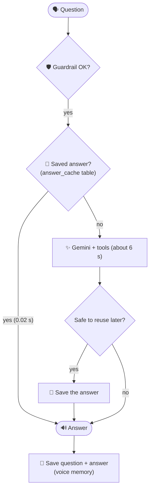

### When is an answer saved? (a cache must never give a wrong answer)

| Rule | Example that is **not** saved | Why |
|---|---|---|
| No time-sensitive words | "What's the **weather** in Mumbai?" | It changes every hour |
| No conversation words (it, that, again...) | "How can I prevent **it**?" | "It" means something different in each chat |
| Only stable tools (PDF search, Wikipedia, calculator) | "Convert 100 dollars to rupees" | Exchange rates change |
| No actions | "**Open** Notepad" | The action must really run again |
| No errors | "Sorry, Gemini is busy" | Never remember a failure |
| PDF answers expire when the PDFs change | (automatic) | A new PDF may change the answer |
| Every answer expires after 30 days | (automatic) | Keeps the memory fresh |

"Hey Jarvis, can you tell me what is Overfitting?" and "what is overfitting" are treated as the **same**
question: the text is normalised (lower case, punctuation and filler words removed).

### Where it lives

| File | Job |
|---|---|
| `backend/migrations/005_create_answer_cache.*.sql` | The new `answer_cache` table (migration 005) |
| `backend/repositories/answer_cache_repository.py` | SQL for saved answers (with an "upsert": `INSERT ... ON CONFLICT DO UPDATE`) |
| `backend/services/answer_cache.py` | The rules above: normalise, decide what's safe, check the PDFs haven't changed |
| `backend/services/desktop_memory.py` | Saves voice chats in the same `conversations`/`messages` tables the API uses |
| `agent.py` | `Brain.ask()` checks saved answers first; `create_desktop_brain()` turns memory on |
| `gui.py` | Shows "Instant answer from memory in 0.02 s" or "Answered in 6.4 s" |
| `tests/test_memory.py` | 6 tests: normalising, safety rules, PDF change, memory after a restart |

**Design choices worth mentioning in an interview:**
- **Fail open:** if the cache breaks, Jarvis answers normally. A cache must never stop the main feature.
- **Stored in the database, not in memory**, so it survives restarts. That's different from the weather cache (section 12.9).
- **Shared:** a question answered by voice is instant through the API too, because both use the same table.
- **The tool tracker:** `Brain` wraps every tool to record which ones answered, so only stable answers are saved.

### Commands
```powershell
.\.venv\Scripts\python.exe -m backend.manage memory          # see saved answers and voice chats
.\.venv\Scripts\python.exe -m backend.manage clear-answers   # forget all saved answers
```
The desktop app creates and updates its database tables by itself, so there are no commands to run.

---

## 17. Noise handling: Voice Activity Detection (VAD)

**Before:** "someone is talking" meant "the sound is loud", so a fan, music or a door counted as talking.
**Now:** a small neural network, **Silero VAD** (2 MB, under 1 ms per 32 ms of sound, runs on the CPU), asks
*"is this a human voice?"* for every 32 ms of sound.

| Sound | Counted as voice (tested) |
|---|---|
| Speech | ✅ yes (probability up to 1.00) |
| Fan / AC rumble | ❌ 0% of frames |
| White noise (hiss) | ❌ 0% of frames |
| A beeping tone | 8% of single frames, filtered out by the "0.2 s of voice to start" rule |

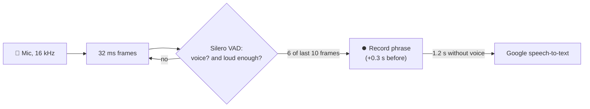

- A phrase **starts** when 6 of the last 10 frames are voice (about 0.2 s), and keeps the 0.3 s before it so the first syllable isn't lost.
- It **ends** after 1.2 s without voice, even if the fan keeps running. Before, a loud fan could keep a phrase going for 10 s.
- **Honest limit:** VAD can't tell *your* voice from a TV or other people talking, because those are voices too.
  The wake word ("Hey Jarvis") handles that. The next step would be an on-device wake-word model (openWakeWord).
- The model downloads once (2 MB) into `.models/silero/`. If it can't, Jarvis falls back to loudness only.
  `JARVIS_VAD=off` in `.env` turns VAD off.
- Code: `voice.py` (`SileroVAD`, `vad_phrases`). Tests: `tests/test_vad.py` (real Windows speech mixed into fan noise).
